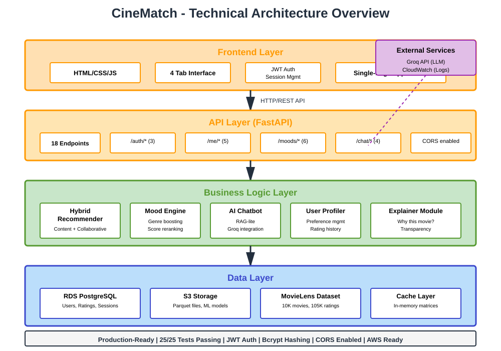

# CineMatch - Project Diagrams

This directory contains all architectural and workflow diagrams for the CineMatch Movie Recommender System.

## Available Diagrams

### 1. AWS Architecture Diagram

**File:** `aws-architecture.svg`

Shows the simplified AWS cloud deployment architecture with 5 essential services:
- Amazon EC2 (FastAPI application)
- Amazon RDS (PostgreSQL database)
- AWS S3 (Data storage)
- Secrets Manager (API keys & credentials)
- CloudWatch (Monitoring & logs)

---

### 2. User Workflow Diagram

**File:** `user-workflow.svg`

Illustrates the complete user journey:
1. Sign Up
2. Select Favorite Genres
3. Get Recommendations
4. Rate Movies
5. Explore Features (Mood, Chatbot, Profile)
6. Receive Better Suggestions (continuous learning)

---

### 3. Technical Architecture Overview

**File:** `technical-architecture.svg`

Shows the layered application architecture:
- **Frontend Layer:** HTML/CSS/JS single-page application
- **API Layer:** FastAPI with 18 RESTful endpoints
- **Business Logic Layer:** Hybrid recommender, mood engine, AI chatbot, user profiler
- **Data Layer:** RDS PostgreSQL, S3 storage, MovieLens dataset, cache

---

### 4. Data Flow Diagrams

**File:** `data-flows.svg`

Contains 4 detailed operational flows:

#### a) User Signup Flow
Browser → FastAPI → RDS → Secrets Manager → JWT Token

#### b) Personalized Recommendations Flow
User (JWT) → FastAPI → RDS (genres) + S3 (data) → Compute → JSON response

#### c) Chatbot Conversation Flow
User message → FastAPI → S3 (search) → Groq API → AI response

#### d) Mood-Based Recommendations Flow
User mood → FastAPI → S3 data → Base recommendations → Apply mood boost → Re-rank

---

## Usage

These SVG diagrams can be:
- Embedded in documentation (Markdown, HTML)
- Included in presentations
- Printed for reports
- Viewed directly in web browsers

## Format

All diagrams are in SVG (Scalable Vector Graphics) format for:
- ✅ Resolution independence (scalable to any size)
- ✅ Small file size
- ✅ Web-friendly
- ✅ Professional quality

---

**Project:** CineMatch - Movie Recommendation System  
**Module:** Cloud Computing & GenAI  
**Architecture:** Hybrid Content-Collaborative Filtering with AI
